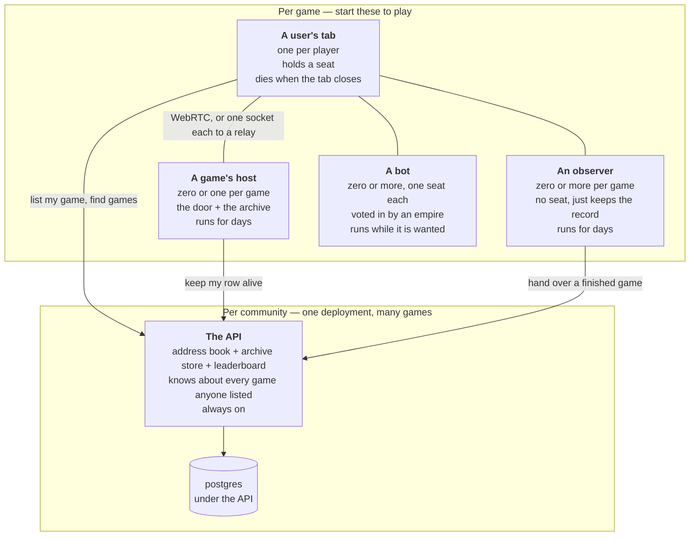
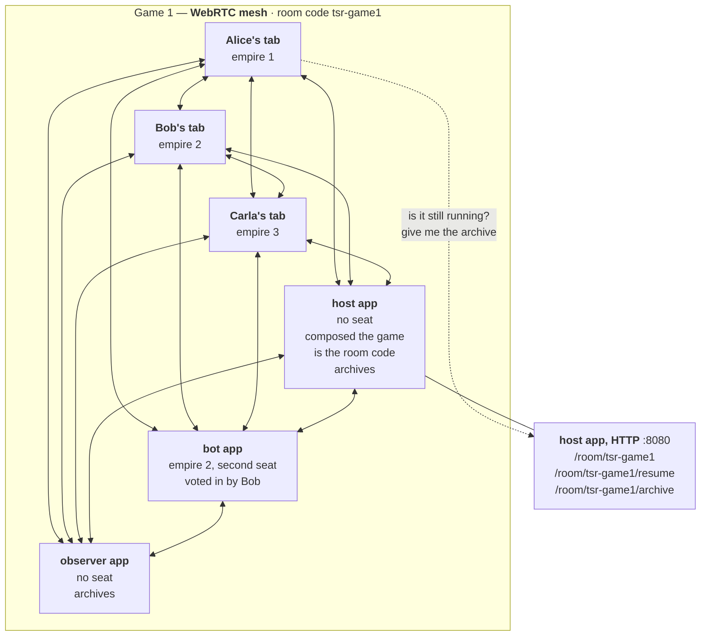
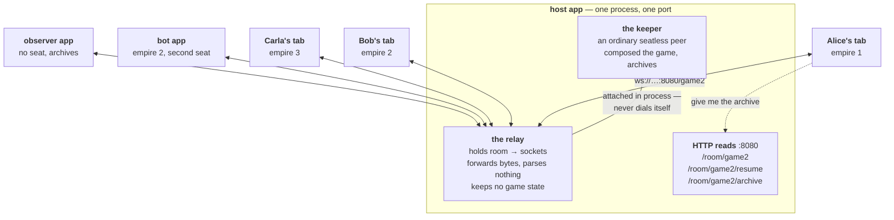
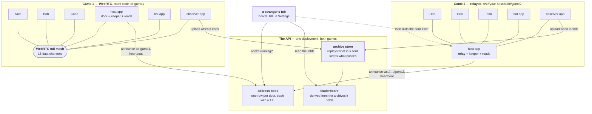
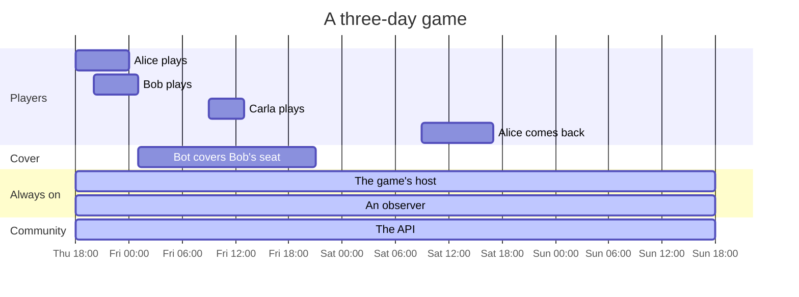

# Running Tessera: the instances, and what to start

What processes exist, who runs each one, how long it lives, and what you need
running before you can test p2p and non-p2p play.

The one idea to hold onto: **only two kinds of instance matter to a game — the
ones that hold a seat and the ones that hold a door.** Everything else is a
convenience that can be switched off without the game noticing.

---

## 1. The instances



| Instance | How many | Who runs it | What dies with it |
|---|---|---|---|
| **A user's tab** | one per player | each player | their seat goes quiet; if they were also the door, the door closes |
| **A game's host** | 0 or 1 per game | whoever wants the game to survive | the door, and the HTTP reads — not the game, if anyone else is still in it |
| **An observer** | any number | anyone | one copy of the record |
| **A bot** | one per seat it covers | the empire that voted it in | that seat goes quiet |
| **The API** | one per community | one operator | discovery and the shared leaderboard. No game stops |

The asymmetry to notice: **the API cannot stop a game or change its outcome.**
A game with no API, no host and no observer is a complete game — it just can't
be found by strangers and vanishes when the last tab closes.

Nothing else is an instance. A WebRTC link needs a broker to introduce the two
ends, and about one pair in five needs a TURN relay to carry its packets — but
those are properties of the link, not processes in the system. You don't run
them, they hold nothing, and the diagrams below draw them as what they are: the
line between two peers.

---

## 2. One game over WebRTC

Six instances: three people in browser tabs, and three programs. The host app
composed the game and its address is the room code; the bot holds a second seat
in Bob's empire; the observer just keeps a copy.



**Six peers, fifteen connections.** Every peer holds a direct data channel to
every other peer, and every signed move is sent once per peer. That's the n²
the next diagram replaces.

Notes on this shape:

- **The host app is not in the middle of anything.** In WebRTC mode it is a
  door, a keeper and a set of HTTP reads — not a relay. Frames between Alice and
  Bob never touch it.
- **The room code is the host app's own peer address.** That's what makes the
  host worth running: Alice can close her laptop and the room is still there.
- **Every line is a WebRTC data channel.** Opening one needs a broker to
  introduce the two ends; once the channel is up the broker is out of the loop,
  and it never sees a move either way. It's part of how a link gets made, not
  something in the picture.
- **The bot and the observer need native WebRTC** (`node-datachannel`) to be in
  this room at all.
- **Some of these lines are secretly relayed.** Roughly one pair in five sits
  behind symmetric NAT and its packets go via TURN. Still peer-to-peer as far as
  the game is concerned: a relay carrying one pair can drop packets and nothing
  else.

What's running:

```sh
pnpm --filter @tessera/host     start --transport rtc --as tsr-game1 --port 8080 --auto 3
pnpm --filter @tessera/bot      start tsr-game1 --apply 2
pnpm --filter @tessera/observer start tsr-game1 --as watcher-1
# three browser tabs join by typing:  tsr-game1
```

---

## 3. The same game over a relay

Identical cast, identical seats, identical signed moves. The host app now also
runs the relay, and every frame goes through it.



**Six peers, five connections.** Everyone holds one socket. A move is sent once
and the relay fans it out.

Notes on this shape:

- **No broker, no TURN, no NAT problem.** Players connect the way they connect
  to any website. A player behind a corporate firewall who couldn't join the
  first game can join this one.
- **The room is a URL, not a peer.** `ws://your-host:8080/game2` stays valid
  whether or not anyone is in it — including before the game starts and after
  everybody leaves.
- **The bot and the observer load no native WebRTC**, which is the difference
  between an install that works on a small VPS and one that doesn't.
- **The relay is closed by default** to rooms it isn't hosting; a stranger
  asking for another room is told nothing is running there.
- **What the relay can do:** drop, delay, reorder — and one thing a TURN relay
  can't, carry everyone but one player. Silence Carla and the others stall on
  her, then vote her out. Denial of play escalating to ejection, never authority,
  and the ejection is a signed record in every copy of the archive.
- **The host never reconnects to itself.** Its keeper is attached internally, so
  a bug in reconnect handling shows up in all five others and never in the host.

What's running:

```sh
pnpm --filter @tessera/host     start --transport wss --room game2 --bind 0.0.0.0 --port 8080 --auto 3
pnpm --filter @tessera/bot      start ws://your-host:8080/game2 --apply 2
pnpm --filter @tessera/observer start ws://your-host:8080/game2 --as watcher-2
# three browser tabs join by typing:  ws://your-host:8080/game2
```

---

## 4. Both games at once

Two games, twelve instances, sharing exactly one thing — and it isn't the game.



The point of putting them side by side:

- **Transport is a per-game choice, not a deployment mode.** Nothing is
  configured to make game 1 p2p — the room code somebody typed had no scheme on
  it, so it's a peer address. Game 2's had `ws://`, so it's a relay. That string
  is the entire toggle: no probe, no fallback, no setting.
- **The two games share no state, no process and no trust.** Different hosts,
  different bots, different observers, different archives.
- **The API is per-community, not per-game.** It's the only instance that knows
  both games exist. Turn it off and both games keep running — you just can't
  find them or see a combined table.
- **A row on the board is a claim, not a game.** The stranger's tab re-derives
  everything it can from the sealed record attached to the row, then dials the
  door to see whether anybody is actually home. It never takes the board's word
  for who's playing or whether the game is joinable.
- **Uploading an archive isn't reporting a result.** The store replays every
  move against the signatures and reaches the final state itself; anyone holding
  the same files computes the same table.

---

## 5. Lifetimes — why a host instance exists at all



Tabs come and go. The seats they hold go quiet and their empires idle, but the
game doesn't stop — the world turns on elapsed time, so a player returning after
six hours has a quarter of a million steps to catch up on and gets handed a
snapshot to do it from.

That snapshot has to come from *someone who's still there*. That is the entire
argument for running a host or an observer instance: not authority, just
presence.

---

## 6. What to start

```sh
pnpm install
pnpm build     # the headless instances run from compiled output
```

### Solo — nothing but the tab

```sh
pnpm dev       # http://localhost:1234
```

### P2P — two tabs, no servers

```sh
pnpm dev
```

Tab A hosts a game and shows a room code. Tab B — a different browser profile or
a private window, since identity is per-profile — pastes it into the join box.

Add long-lived instances to the same room:

```sh
pnpm --filter @tessera/observer start <room-code> --as nightwatch --dir ./archives
pnpm --filter @tessera/bot      start <room-code> --apply 2 --play defend
```

`--as nightwatch` is what makes that observer a second door. `--apply 2` makes
the bot ask empire 2 for a seat and keep asking until they vote it in.

### Non-p2p — a relay you own

```sh
# terminal 1: relay + keeper + reads, one process
pnpm --filter @tessera/host start \
  --transport wss --bind 127.0.0.1 --port 8080 --room dev \
  --auto 2 --wait 120 --dir ./archives

# terminal 2
pnpm dev
```

It prints `ws://127.0.0.1:8080/dev`. Paste that into the join box in two tabs.
`--auto 2` seals a two-empire game as soon as both players are present;
`--plan <file>` instead names an exact roster, and `--propose <secs>` puts a
world on the table and seats whoever signs it.

Headless instances join the same string:

```sh
pnpm --filter @tessera/observer start ws://127.0.0.1:8080/dev --as second-keeper
pnpm --filter @tessera/bot      start ws://127.0.0.1:8080/dev --apply 2
```

### The API

```sh
docker compose -f apps/api/compose.yaml up --build     # board + store + postgres
```

or, with rows in memory and no database:

```sh
pnpm --filter @tessera/api start --bind 127.0.0.1 --port 8081 --archives ./store
```

Then in the tab's **Settings** (served over `http` by `pnpm dev`, so a plain
`http://` board is readable):

- Address book → `http://127.0.0.1:8081/games`
- Archive URLs → `http://127.0.0.1:8081/archives/<gameId>`, or
  `http://127.0.0.1:8080/room/dev/archive` straight from the host instance

Tick **List this game publicly** when creating a game and it shows up in the
other tab's Games card. Or have the host keep its own row alive:

```sh
pnpm --filter @tessera/host start --transport wss --port 8080 --room dev \
  --auto 2 --announce http://127.0.0.1:8081/games --ttl 180
```

### No instances at all

```sh
pnpm test      # six peers in one process, deterministic delivery order
pnpm replay    # a whole game headless, prints the resulting state hash
```

---

## 7. What you need running, per thing you want to test

| To exercise | Instances to start | What players type |
|---|---|---|
| Solo play, rendering, input | dev server | — |
| **P2P** | dev server, two browser profiles | the room code |
| **Non-p2p** | dev server + a host | `ws://127.0.0.1:8080/<room>` |
| A seat covered by a program | + a bot | either |
| Archives, verification, local leaderboard | + an observer | either |
| Discovery, listing, joining a stranger's game | + the API, board URL in Settings | either |
| A game outliving the tab that started it | a host, or an observer with a fixed name | either |
| Resuming a game nobody is in | a host serving its resume endpoint | relayed is easiest |
| Reconnect after a network blip | host, then suspend it briefly | `ws://…` |
| NAT traversal / TURN | two machines on different networks | the room code |

Two asymmetries worth knowing before you go hunting bugs:

- **The host never reconnects to itself.** Its keeper attaches to its own relay
  internally, so any bug in reconnect handling shows up in players and never in
  the host.
- **A tab is not a process.** A swiped phone, a crashed tab and a closed lid all
  skip every cleanup hook, so an address book row expires rather than being
  withdrawn.

---

## 8. Instances that don't exist yet

- **A host service** — something you'd POST to and get a fresh room back. Only
  the request shape ships; the Settings field for it stays empty and hides the
  option.
- **A default address book.** None ships, none is assumed.
- **A game composed by more than one person.** Whoever presses start seals it
  alone, so two people in one empty room can each start a game. Agree who
  presses it.
